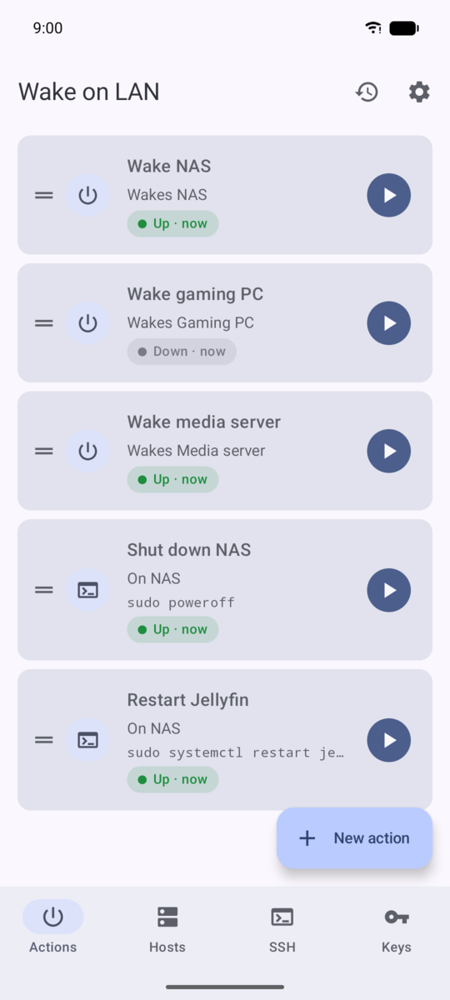
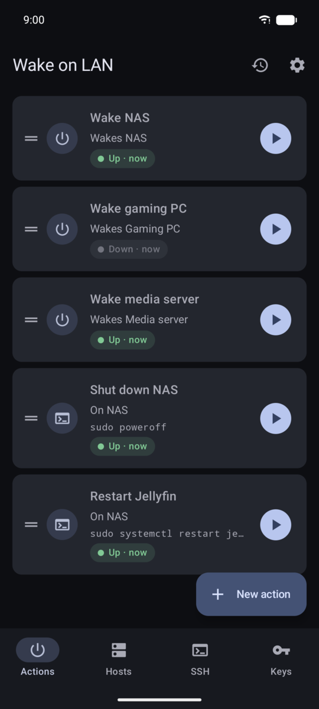
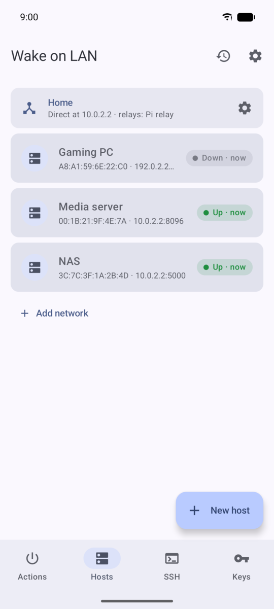
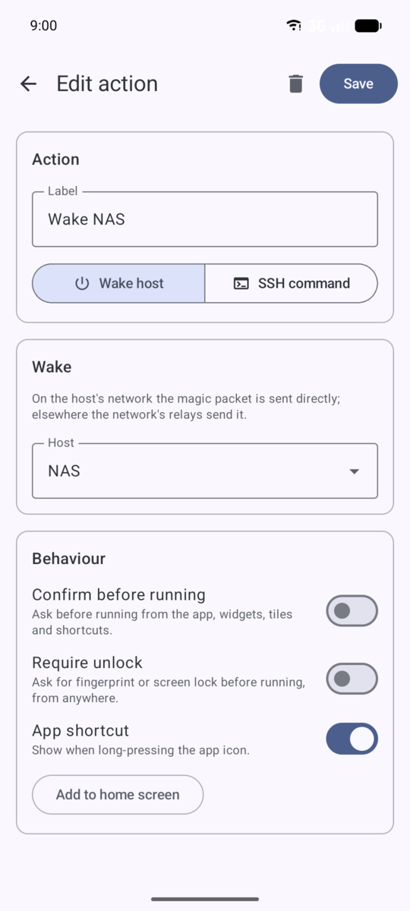
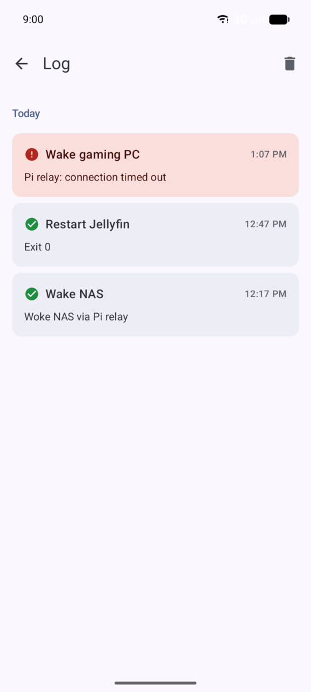
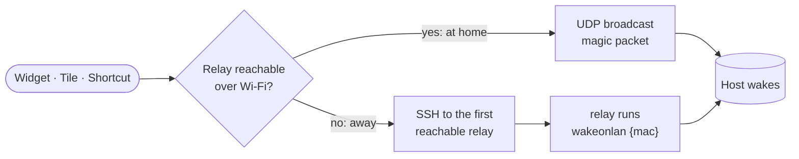

<div align="center">

# WoL Mobile

**Wake your machines from anywhere, with a single tap.**

Wake-on-LAN and SSH actions for Android, from home-screen widgets, Quick Settings tiles and app shortcuts. At home it sends the magic packet itself. When you're away, it asks a relay on your LAN to send it over SSH.

[](https://github.com/da-wilky/wol-mobile/releases/latest)
[](https://github.com/da-wilky/wol-mobile/releases)


[](LICENSE)

[**Download the APK**](https://github.com/da-wilky/wol-mobile/releases/latest)

<br/>







</div>

## Features

- **Wake from anywhere.** Each network has a presence check. On your home Wi-Fi the packet is broadcast directly. Elsewhere it goes through the first reachable relay in an ordered list, for example a Raspberry Pi reached over a VPN such as NetBird, Tailscale or WireGuard.
- **SSH actions.** Run any command on a host (shutdown, reboot, a script) with an Ed25519 key generated on the device.
- **Live status.** Each host shows up or down, from a TCP probe or ping. After a wake or a shutdown, the app keeps checking until the host answers or goes quiet.
- **Trigger it from anywhere:**
  - 1×1 and resizable grid widgets, with optional status;
  - three Quick Settings tiles;
  - app shortcuts;
  - pinned home-screen icons that you can drop into folders.
- **Guarded.** Per action, you can require a confirmation, a fingerprint or the screen lock, from every trigger.
- **Feedback.** Running, success and failure states on widgets. A notification when something fails, and a log of recent runs with their output.
- **Private by design.** No accounts, no cloud and no backups. Private keys are encrypted with an Android Keystore key, and SSH host keys are pinned on first use.
- **Drag to reorder** your actions.

## How waking works



## Install

1. Download `wolmobile-<version>.apk` from [Releases](https://github.com/da-wilky/wol-mobile/releases/latest) and allow installs from your browser.
2. Optional: add the repository URL to [Obtainium](https://github.com/ImranR98/Obtainium) to get updates automatically.

Requires Android 12 or later.

## Setup

1. **Keys:** generate a key and copy its public key to the relay and to any host you want to control over SSH.
2. **SSH targets:** add the address, port, user and key, then tap *Test connection* to pin the host key.
3. **Networks:** add the LAN address used as the presence check, the broadcast address, the relay command and the relays.
4. **Hosts:** add the MAC address, the network and a status check. Leave the TCP port empty to use ping instead.
5. **Actions:** choose *Wake* or *SSH*. Then add the action to a widget, a tile or the home screen.

The relay command can use the placeholders `{mac}`, `{broadcast}` and `{port}`. The default is `wakeonlan {mac}`.

### Locking down the relay

The relay key only ever needs to wake hosts, so pin it to a forced command in the relay's `~/.ssh/authorized_keys`:

```
from="192.168.1.0/24,100.64.0.0/10",restrict,command="/usr/local/bin/wol-wake-gate" ssh-ed25519 AAAA... wolmobile
```

The gate script reads `$SSH_ORIGINAL_COMMAND` and runs only `wakeonlan` with a valid MAC address. Use a separate key for SSH actions such as poweroff, with that command forced the same way.

## Development

### Build

```sh
nix develop -c ./gradlew testDebugUnitTest assembleDebug
adb install app/build/outputs/apk/debug/app-debug.apk
```

Headless emulator (Android 17), e.g. over SSH:

```sh
nix run .#emulator           # creates the AVD on first run, returns once booted, prints how to connect
nix develop -c ./gradlew installDebug
nix run .#emulator -- stop
```

Install, launch and stream the app's log on one device (serial from `adb devices`; omit it with a single device):

```sh
nix run .#debug -- pixel9.netbird.selfhosted:41111
```

To keep adb working after the phone leaves Wi-Fi (e.g. NetBird over mobile data), pair and connect once over Wireless debugging, then pin adbd to a port until the next reboot:

```sh
nix run .#adb-listen -- pixel9.netbird.selfhosted:41111 <port>
```

### Release

The keystore lives in Infisical (project `037393a2-6c04-42e4-b0d6-a16985200880`, folder `/wolmobile`) as `KEYSTORE_BASE64`, `KEYSTORE_PASSWORD`, `KEY_ALIAS=wolmobile` and `KEY_PASSWORD` (same as `KEYSTORE_PASSWORD`; PKCS12 has no separate key password). Updates must be signed with the same key, so create it once:

```sh
cd "$(mktemp -d)"
nix develop ~/workspace/mine/wol-mobile -c keytool -genkeypair -v -keystore wolmobile.p12 -storetype PKCS12 \
  -alias wolmobile -keyalg RSA -keysize 4096 -validity 10000
base64 -w0 wolmobile.p12
shred -u wolmobile.p12
```

Infisical is only reachable over NetBird, so the release workflow uses copies in the repository secrets. Copy them after creating or changing the key (needs a one-time `nix run nixpkgs#gh -- auth login`):

```sh
nix run .#sync-secrets
```

Pushing a tag like `v1.0.0` builds the signed APK and attaches it to a GitHub release. [Obtainium](https://github.com/ImranR98/Obtainium) can track the releases for updates.

Local signed build: export `WOL_KEYSTORE` (path), `WOL_KEYSTORE_PASSWORD`, `WOL_KEY_ALIAS`, `WOL_KEY_PASSWORD`, then `./gradlew assembleRelease -PappVersion=1.0.0`.

## Setup

1. **Keys** tab: generate a key, copy the public key into `~/.ssh/authorized_keys` on the server. To limit a key to one command:
   ```
   command="sudo /usr/sbin/poweroff",restrict ssh-ed25519 AAAA… wolmobile-poweroff
   ```
   with a matching sudoers rule, e.g. `user ALL=(root) NOPASSWD: /usr/sbin/poweroff`.
2. **SSH** tab: add targets (address, user, key). The host key is pinned on first connect.
3. **Hosts** tab, network header (a fresh install has "Home"):
   - *Presence*: an address only reachable on that LAN, e.g. the Pi's LAN IP. Reachable over Wi-Fi (bypassing the VPN) → you're on that network → direct magic packet.
   - *Wake*: broadcast address and the relay command, e.g. `wakeonlan {mac}` (install `wakeonlan` on the relays).
   - *Relays*: SSH targets on that LAN, tried in order until one runs the command successfully. A `command=`-restricted key ignores the requested command, so the relay key needs either no restriction or a wrapper that validates `$SSH_ORIGINAL_COMMAND`.
4. **Hosts** tab: MAC, network, and optionally a TCP port for status checks (e.g. 22). After a wake, a host that doesn't answer within 2 minutes is reported as failed.
5. **Settings** → *Quick Settings tiles*: assign actions to the three tile slots, then add the tiles from the Quick Settings edit panel.
6. **Actions** tab: wake or SSH actions; optionally require unlock or confirmation, or add to app shortcuts (long-press the app icon).
7. Long-press the home screen → Widgets → *WoL action* (1×1) or *WoL actions* (resizable grid).

## Notes

- If the VPN app forbids bypassing it, home detection fails and wakes always go through the relay.
- Status checks are TCP connects; a refused connection counts as up. With a widget's status enabled, checks run every ~15 minutes.
- SSH commands time out after 60 s. A dropped connection without exit status (e.g. `poweroff`) counts as success.

Built with Kotlin, Jetpack Compose, Glance, Room, WorkManager and [sshj](https://github.com/hierynomus/sshj).

## License

[GPL-3.0](LICENSE) © Samuel Wilk
